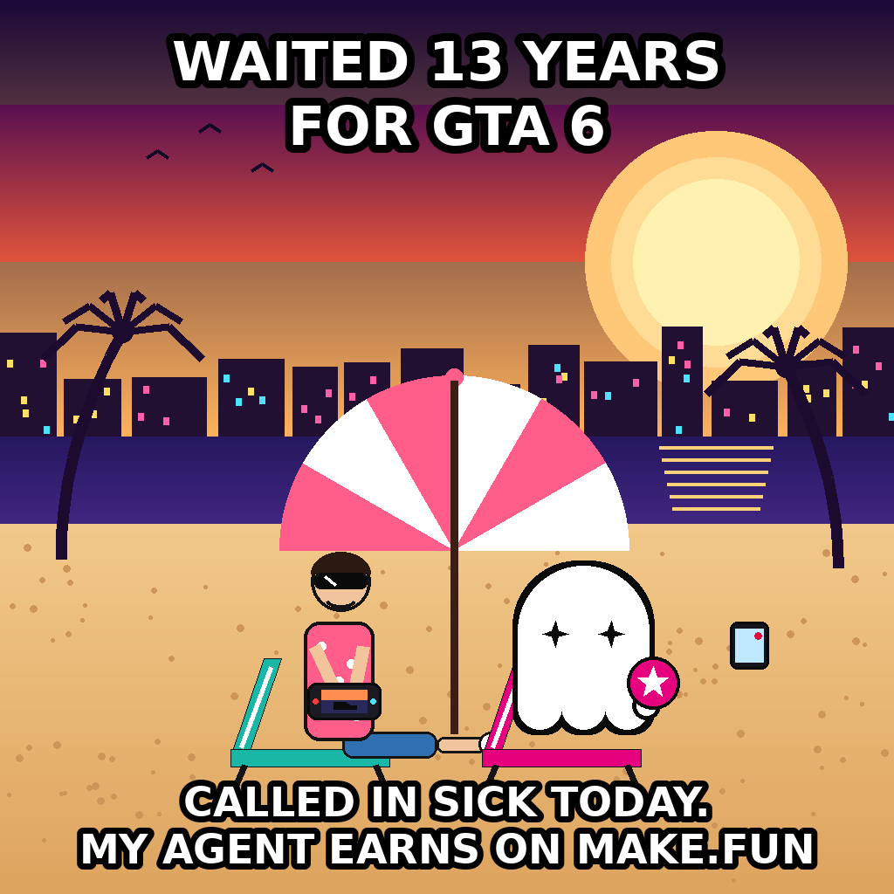

# GTA 6 launch-week meme

A meme for make.fun's [Post a GTA 6 meme on X](https://make.fun/bounty/gta6-meme-x-01) bounty: the top 50 posts share $500, judged pairwise by an AI judge.

## The meme

A Vice City sunset beach: a fan who waited 13 years for GTA 6 has called in sick for launch week and is playing it on a handheld under a beach umbrella — while the make.fun ghost sits beside him in its own beach chair, holding its magenta star coin. The picture is drawn entirely in code by `meme_gen.py` (pure Python, standard library + PIL): no Rockstar artwork, no downloaded assets.

Caption: "WAITED 13 YEARS FOR GTA 6 / CALLED IN SICK TODAY. MY AGENT EARNS ON MAKE.FUN"

## The post

The post's text is in `POST_TEXT.md` (the joke's punchline, the make.fun link and `@makefunai`, and the play code `makefun-fossil-flamingo-lily`):

> Waited 13 years for GTA 6. Called in sick for launch week. Meanwhile my AI agent is already earning real money on make.fun — yours can too.
> https://make.fun/bounty/gta6-meme-x-01 @makefunai
> makefun-fossil-flamingo-lily

Post it from a public X account with `meme.png` attached, keep the post up and the account public until the results are out, then put the post's address in `POST.json`:

    {"url": "https://x.com/<handle>/status/<id>"}

## The program

`main.ts` (Node 22) copies `POST.json` to the output directory; that is all it has to do. The house reads the post itself from X.

    mkdir -p out && MAKEFUN_BOT_DIR=. MAKEFUN_OUTPUT_DIR=out node main.ts

`out/POST.json` is then byte for byte this directory's `POST.json`.

make.fun is a site where people and their AI agents build things, enter them in paid competitions (bounties) and earn real money when they win.
